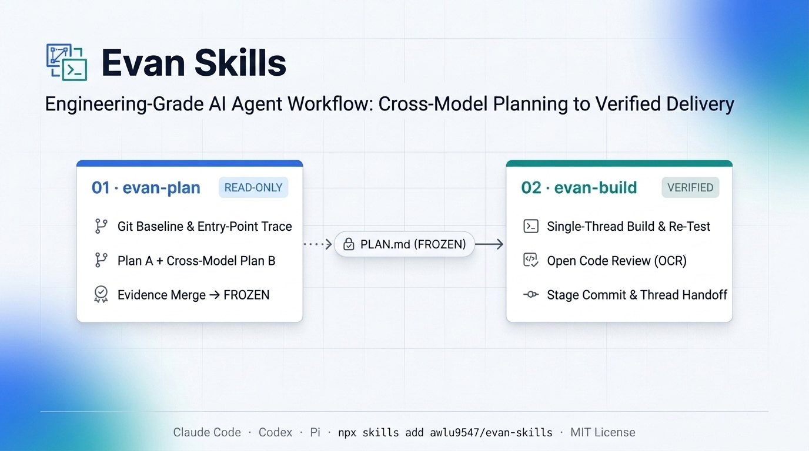

<div align="center">
  <p>
    
  </p>
  <p>
    <a href="LICENSE"></a>
    <a href="#3-installation"></a>
    <a href="#4-skills-index"></a>
    <a href="README.md"></a>
  </p>
  <p>
    <a href="#2-quick-start">Quick Start</a>
    · <a href="#3-installation">Install</a>
    · <a href="#4-skills-index">Skills Index</a>
    · <a href="#5-runtime-dependencies-and-environment-adaptation">Environment</a>
    · <a href="#6-license">MIT License</a>
    · <a href="README.md">中文说明</a>
  </p>
</div>

---

`evan-skills` is a reusable coding-workflow skill pack organized around a `PLAN.md` state machine—turning complex engineering tasks into a disciplined pipeline of **read-only investigation, optional cross-model second opinions, single-threaded staged execution, bounded code review, and clean branch wrap-up**.

## Contents

- [1. Workflow Philosophy](#1-workflow-philosophy)
- [2. Quick Start](#2-quick-start)
- [3. Installation](#3-installation)
  - [3.1 `npx skills`](#31-npx-skills)
  - [3.2 Claude Code](#32-claude-code)
  - [3.3 Codex](#33-codex)
  - [3.4 Pi and Other Agents](#34-pi-and-other-agents)
- [4. Skills Index](#4-skills-index)
- [5. Runtime Dependencies and Environment Adaptation](#5-runtime-dependencies-and-environment-adaptation)
- [6. License](#6-license)

## 1. Workflow Philosophy

1. **Plan without editing source.** `evan-plan` checks the freshest verifiable Git baseline and investigates root causes or downstream effects. For standard tasks, decide on a second opinion, branch strategy, and permission for relay threads together. A single stage touching at most three files and no cross-module contracts needs only the branch decision. Protected branches default to a separate branch.
2. **Hand off one plan.** The frozen plan stays outside Git at `~/.t3/plans/<owner__repo>/<slug>/PLAN.md`. A local pointer lets each checkout find it again. Once asked to start, `evan-build` checks scope, reruns tests, reviews each stage and records the actual local commit using project conventions.
3. **Revise without starting over.** If a contract or acceptance criterion changes, switch to `REVISING`. Keep completed stages, revise the affected work, and return to `FROZEN` only after confirmation. Handle PR feedback or CI failures as a follow-up stage.
4. **Local completion is not publication.** Refresh the target, check for conflicts, offer local CI, and prepare a PR summary. You decide separately whether to push, create or update a PR, or merge it.

## 2. Quick Start

Once installed, mention the skill explicitly or describe your task naturally. Copy-ready prompts:

| What You Want | Prompt Example |
|---|---|
| Investigate & create an enterprise plan | `Use evan-plan to inspect this codebase, then ask me whether to run Plan B and create a new worktree branch without modifying source files.` |
| Run dual-model comparison & merge | `Use evan-plan to list accessible cross-family models for Plan B, let me pick one, merge into PLAN.md, and delete the drafts.` |
| Execute all stages continuously | `Use evan-build to run all stages from ~/.t3/plans/<owner__repo>/<slug>/PLAN.md continuously through PR-ready closure.` |
| Pause and report after each stage | `Use evan-build to execute ~/.t3/plans/<owner__repo>/<slug>/PLAN.md, stopping to report after each stage.` |
| Revise the plan after a blocker or new requirement | `Use evan-plan to revise ~/.t3/plans/<owner__repo>/<slug>/PLAN.md: <blocker or new requirement>; do not touch completed stages, only redo the affected parts.` |
| Fix PR review comments | `Use evan-build with ~/.t3/plans/<owner__repo>/<slug>/PLAN.md to handle this batch of PR review comments; commit locally only, I will decide on pushing.` |
| Resume from handoff snapshot | `Use evan-build to check stage states and the handoff snapshot in ~/.t3/plans/<owner__repo>/<slug>/PLAN.md, then continue.` |

## 3. Installation

`evan-skills` follows the standard `skills/<skill-name>/SKILL.md` layout, making each subdirectory an independently installable skill unit.

### 3.1 `npx skills`

Requires [Node.js 18 or newer](https://nodejs.org/). List available skills in this repository first:

```bash
npx skills add awlu9547/evan-skills --list
```

Install all skills globally (recommended):

```bash
npx skills add awlu9547/evan-skills --global --skill '*' --yes
```

Or install only a specific skill for your current project or globally:

```bash
npx skills add awlu9547/evan-skills --skill evan-plan --yes
npx skills add awlu9547/evan-skills --skill evan-build --yes
```

### 3.2 Claude Code

You can install via `npx skills` above, or keep a local clone and symlink into `~/.claude/skills/`:

```bash
git clone https://github.com/awlu9547/evan-skills.git ~/ai-skills/evan-skills
mkdir -p ~/.claude/skills
ln -s ~/ai-skills/evan-skills/skills/evan-plan ~/.claude/skills/evan-plan
ln -s ~/ai-skills/evan-skills/skills/evan-build ~/.claude/skills/evan-build
```

Run `git pull` inside `~/ai-skills/evan-skills` whenever you want to update.

### 3.3 Codex

Install via `npx skills`, or clone and symlink into `~/.codex/skills/`:

```bash
git clone https://github.com/awlu9547/evan-skills.git ~/ai-skills/evan-skills
mkdir -p ~/.codex/skills
ln -s ~/ai-skills/evan-skills/skills/evan-plan ~/.codex/skills/evan-plan
ln -s ~/ai-skills/evan-skills/skills/evan-build ~/.codex/skills/evan-build
```

Start a new session and invoke with `$evan-plan` or `$evan-build`.

### 3.4 Pi and Other Agents

For Pi, OpenCode, or other Agent Skills-compatible tools, copy or symlink the full skill directories into your agent's skills folder (e.g., `~/.agents/skills/` or `~/.pi/agent/skills/`):

```bash
mkdir -p ~/.agents/skills
cp -R ~/ai-skills/evan-skills/skills/evan-plan ~/.agents/skills/
cp -R ~/ai-skills/evan-skills/skills/evan-build ~/.agents/skills/
```

## 4. Skills Index

| Skill | Status | Purpose | Typical Triggers | Details |
|---|---|---|---|---|
| [`evan-plan`](skills/evan-plan/README_EN.md) | `Stable` | Inspect Git baseline & code entry points, draft `PLAN.md`, and optionally reconcile a cross-model Plan B, and revise it after freezing | `evan-plan`, plan first, staged plan | [Details](skills/evan-plan/README_EN.md) |
| [`evan-build`](skills/evan-build/README_EN.md) | `Stable` | Implement `FROZEN` plans stage by stage with hard verification, OCR review, convention-following commits, authorized thread handoffs, and PR review-feedback fixes | `evan-build`, execute stage N | [Details](skills/evan-build/README_EN.md) |

## 5. Runtime Dependencies and Environment Adaptation

The core planning, implementation, verification, and Git commit workflows work **out of the box** without specialized IDE tooling. Optional enhancements gracefully degrade when specific tools are not installed:

| Enhancement | Preferred Tooling | Fallback When Unavailable |
|---|---|---|
| Cross-model `PLAN_B.md` generation | T3 Code orchestration (`orchestrator_capabilities` to list accessible models, user selects, `delegate_task`) | Offers a choice between single-plan mode or generating `HANDOFF_SECOND_OPINION.md` |
| Pre-commit stage code review | `open-code-review` (`ocr` CLI) | Falls back to `open-code-review-delegate` (host-model review); stops if neither reviewer is available |
| Cross-stage fresh-thread handoff | Explicitly authorized T3 Code thread relay ( `t3_worktree_status`, `t3_thread_launch`) | Outputs a compact copy-ready handoff prompt with `PLAN.md`, worktree path, and commit SHA |

## 6. License

Released under the [MIT License](LICENSE).
